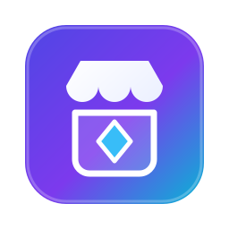

<div align="center">



# AGY Market · 反重力插件市场 (`agy-market`)

**Google Antigravity 社区插件市场**

Sidebar 侧边栏界面 · 锁安全一键卸载 · Sidebar 上游直装与一键更新 · 15 大精准分类 · GitHub 完整链接预检安装 · ⭐ 插件收藏栏 · 已安装实时搜索筛选 · 一键直开 Sidebar 侧边栏 · 卡片原生启停滑块 · 本地插件冲突检查 · 双通道中国镜像加速 · SHA-256 校验

**简体中文** · [English](./README.en.md) · **[📖 申请收录插件教程](https://github.com/azwosile/agy-market-catalog/blob/main/docs/SUBMISSION_GUIDE.md)** · [插件目录仓库](https://github.com/azwosile/agy-market-catalog) · [架构规范](./AGENTS.md)

</div>

---

> **仓库边界说明**：本仓库（[`azwosile/agy-market`](https://github.com/azwosile/agy-market)）包含 **AGY Market** 客户端 Sidebar 侧边栏、Windows 锁安全安装器、`npx agy-market` 一行安装 CLI 与静态展示站（`site/`）。
>
> 如需将你的插件收录至社区插件目录，点击市场顶部的 **`+ 申请收录插件`** 按钮或直接阅读 **[📖 申请收录插件完整教程 (`docs/SUBMISSION_GUIDE.md`)](https://github.com/azwosile/agy-market-catalog/blob/main/docs/SUBMISSION_GUIDE.md)**，向 **[`azwosile/agy-market-catalog`](https://github.com/azwosile/agy-market-catalog)** 提交单文件 YAML Pull Request。

---

## ✨ 核心特性（v1.5.4）

### 1. Sidebar 侧边栏界面、15 大精准分类与导航体验
- **原生右侧 Sidebar 侧边栏**：基于 Antigravity 原生 `AUX_PANE` 扩展视图（`sidecars/market_pane/sidecar.json`），不捆绑常驻 MCP 服务，打开即用、轻量流畅。
- **15 大精准分类体系（含 `all` 共 16 项）**：新增 **状态与用量监控（`monitoring-quota`）**、**上下文与缓存加速（`context-cache`）**、**多代理与思考控制（`agents-reasoning`）** 等高辨识度细分品类；探索页自动按目录数据动态生成分类胶囊、支持按中英文分类名实时搜索并在卡片与详情抽屉展示分类微标签。
- **顶部概览栏与插件卡片**：顶部可折叠概览栏实时展示「已收录插件 / 运行中 / 可更新 / 本地冲突」，顶栏内置 **`链接添加`**（粘贴任意 GitHub 链接预检安装）与 **`+ 申请收录插件`** 快捷入口；卡片样式适配暗色、亮色与半透明壁纸皮肤（如 Wallpaper Prism）。
- **双行标题 + 一键直达 GitHub**：点击探索卡片、收藏卡片、已安装卡片或详情抽屉的**插件标题**可直接在新窗口打开对应 GitHub 仓库，点击卡片其余区域展开详情抽屉。
- **开箱优先呈现简体中文文档**：详情抽屉请求 `/api/readme?id=...&locale=zh`，自动优先渲染目录源 `entriesZh` 或本地 `README.zh-CN.md` / `README.zh.md`，并在已安装卡片优先显示中文化简介。
- **点击「面板」一键直开目标 Sidebar 侧边栏**：移除会被 Chromium 拦截的裸 `<a href="sidecar://...">` 链接；在宿主侧边栏内点击其他 Sidebar 插件卡片上的「面板」按钮时，直接调用宿主 `window.sidecar.ui.toggleAuxPane`（`tabType: "sidecarView"`）拉起或聚焦对应侧边栏，无需手动复制提示。

### 2. 锁安全一键卸载、Sidebar 全通道直装更新与按需「一键更新」
- **彻底杜绝同版本无效更新（v1.5.4）**：前后端共享 SemVer 严格对账与服务端最新目录源优先机制，消除跨快照状态失步导致的 `vX.Y.Z → vX.Y.Z` 误报与陈旧数据降级重装；常规更新命中已最新或同 Tag/Commit 时免下载短路返回 `ALREADY_UP_TO_DATE`，详情抽屉保留显式「重新同步（`forceResync`）」能力。
- **锁安全插件卸载（Sidebar 卡片/详情抽屉 + `npx agy-market uninstall <dir>`）**：
  - 每张可卸载全局已安装插件卡片与详情抽屉均内置 **「卸载」** 按钮（`POST /api/uninstall`，同时兼容 `/api/remove-files`），确认弹窗支持可选勾选「同时从收藏夹移除」。
  - 统一覆盖活跃目录（`~/.gemini/config/plugins/<dir>`）与停放仓（`${PLUGIN_DATA}/disabled-plugins/<dir>`）；绝不写 `config.json` 或调用受限 RPC；遇到符号链接/NTFS Junction 仅删除链接本身绝不误删源目录；Windows 下遇到 `EBUSY` 文件锁自动 `.old.<ts>` 改名退避并立即摘除 `plugin.json`，下次启动由 `sweepRetiredBinaries` 自动清扫残留空壳目录；硬性拦截 `agy-market` 自删（`ERR_CANNOT_SELF_DELETE`）及 `workspace` / `builtin` 插件误删。
- **Sidebar 内全通道直装更新（告别外链手动下载）**：
  - 当检测到 GitHub 上游 Release/Tag 领先于目录版本或来源于 GitHub URL 时，`GET /api/updates` 统一标记 `installable: true`（`updateChannel: 'catalog' | 'github-upstream' | 'github-url'`），点击更新直接在 Sidebar 内完成拉取、预检与原位升级，彻底移除跳转外部浏览器的上游外链按钮。
  - 目录认证插件通过 GitHub 上游通道直装更新时，100% 保留原有 `receipt.track`（如 `'verified'`）与 `repositoryId`，并持续执行能力增量确认门禁。
- **每张已安装卡片配智能「更新 / 最新」状态切换 + 顶栏按需「一键更新」**：
  - 所有具备远端更新源的已安装插件卡片在发现新版本时展示直装 **「更新 vX.Y.Z」** 按钮，更新完成或检查确认为最新版后自动切换为不可点击的 **「✓ 最新」** 提示胶囊（未检查时点击「更新」先核验，若已是最新不重复下载重装）；纯本地无源插件展示不可点击的「本地 / 工作区 / 内置」状态胶囊（接口返回 `ERR_NO_UPDATE_SOURCE`）。
  - 「已安装」页签顶栏在 **「检查更新」** 旁按需显示 **「一键更新 (N)」** 按钮：当检测到可安装更新（或批量更新进行中）时显示，按序批量更新 `catalog`、`github-upstream` 与 `github-url` 全部通道（并将 `agy-market` 自身更新严格排在最后触发重启）；全部插件处于最新版本时自动隐藏，保持界面清爽。

### 3. ⭐ 插件收藏栏、已安装搜索筛选与更新失败告警
- **⭐ 插件收藏栏 & 独立「收藏」标签页**：
  - 每张插件卡片（探索、收藏、已安装）与详情抽屉顶部均内置 `☆` / 琥珀金 `★` 收藏按钮，点击调用 `POST /api/favorites` 原子持久化至本地 `prefs.json`（无需重复配置）。
  - 收藏任意插件后，「探索」页顶部自动浮现可折叠的 **「★ 我的收藏栏」** 快捷入口；顶部导航同步提供独立 **「★ 收藏」** 标签页（`探索 · 收藏 · 已安装 · 冲突与诊断 · 源与设置`），支持全文检索与快速启停/安装。
- **`已安装` 插件实时搜索与状态筛选**：
  - 「已安装」视图配备实时搜索栏（支持按插件显示名、目录名或简介瞬时过滤）与状态筛选胶囊（**全部 / 已启用 / 已停用 / 可更新**），插件再多也能秒级定位。
- **更新失败显著红色告警条（绝不静默失败）**：
  - 当单个安装/更新、批量「全部更新」或市场自更新遇到网络中断、SHA-256 校验不匹配或文件锁异常时，页面顶部立即弹出醒目的红色告警条与错误通知，完整展示失败插件与具体错误原因，并提供一键 **「重试」** 按钮。

### 4. 卡片底部原生「启用 / 禁用」安全停放仓滑块（Vault Parking）
- **零改写 `config.json` 红线**：Antigravity 语言服务器对 `~/.gemini/config/config.json` 设有写保护。AGY Market 严守只读原则，永不改写 `config.json`，而是通过**安全停放仓（Vault Parking）**实现即时启停控制（`POST /api/toggle-plugin`）：
  - **滑向「禁用（OFF）」**：后端将 `~/.gemini/config/plugins/<dir>` 安全移入 `${PLUGIN_DATA}/disabled-plugins/<dir>`，宿主热监听约 1 秒内卸载对应 Skills / Rules / Hooks。
  - **滑向「启用（ON）」**：后端将目录完整移回 `~/.gemini/config/plugins/<dir>` 并清理可能残留的 `"disabled": true`。
  - **停放态持续可更新**：被禁用的插件仍保留在「已安装」与「探索」卡片中；对其执行版本更新时，会在 `disabled-plugins/<dir>` 内原位同步，绝不意外将其自动重新激活。
  - **防误操作锁定**：`agy-market` 自身滑块保持常亮锁定（避免在市场侧边栏内把自己停用断连）；`workspace`、`builtin` 及宿主手动禁用项显示只读锁定提示。

### 5. 本地插件冲突检查与修复
顶部内置独立 **「冲突与诊断」** 标签页（`GET /api/conflicts`），对本地已安装插件执行只读静态检查，并提供一键修复（`POST /api/fix-conflict`）：

| 检测项 | 严重级别 | 检测内容 | 一键修复能力 |
| :--- | :---: | :--- | :--- |
| `duplicate-plugin-name` | 严重 | 跨 `workspace > global > builtin` 扫描重复 `plugin.json.name`，精确标出生效胜出方与被宿主静默丢弃的插件目录 | 一键双连字符隔离重命名（`<owner>--<slug>`） |
| `windows-symlink-ignored` | 严重 | 检测 Windows 下 `~/.gemini/config/plugins/` 中被 `GetAllPlugins` 静默跳过的 NTFS Junction / 符号链接目录 | 一键实体化转为真实目录 |
| `mcp-collision` | 严重 / 警告 | 检测重复 `<plugin>_<server>`、与用户全局 `mcp_config.json` 重名或裸通用服务名（如 `search`、`db`、`fetch`） | 定位冲突键名与来源文件 |
| `skill-shadowing` / `agent-shadowing` | 警告 | 检测已启用插件之间的 `skills/*/SKILL.md`、`agents/*.md` 与用户全局目录或内置保留名的覆盖链 | 完整展示胜出/被覆盖链路 |
| `host-enhancement-overlap` | 警告 / 提示 | 检测多个已启用插件同时修改 `app.asar`（**警告**，需注意文件补丁叠加风险）或同时使用 `cdp` 宿主界面增强（**提示**，通常可共存） | 提示评估是否停用其一 |

### 6. 按需触发的智能重启 / 重开侧边栏提示
卡片与详情抽屉保持视觉清爽，不再堆叠静态「需重启 / 免重启」标签；**仅当安装、更新、批量更新、卸载完成或 Windows 禁用遇到文件锁时**，依据插件能力与实时句柄状态按需弹出精准提示：
- **纯声明式技能 / 全局规则（`instant`）**：热加载即刻生效，免重启无打扰。
- **含 Sidebar 侧边栏 / MCP / 钩子（`reload-pane`）**：更新或安装成功后提示重开侧边栏或刷新 MCP。
- **含 `app.asar` / 首次配置 `cdp` / Windows 锁定退避文件（`host-restart`）**：操作完成后弹出顶部横幅提醒重启 Antigravity 生效。

### 7. 内置 GitHub Discussions 社区讨论
- 插件详情抽屉内置 **「讨论」** 标签页（`GET /api/discussions`），无需登录或 Token 即可自动探测目标仓库是否开启 GitHub Discussions，并提供一键直达讨论区与发帖入口。
- 如在面板设置中可选填入个人 GitHub Token（仅以 `0600` 权限保存在本地 `prefs.json`，绝不写入缓存文件或日志），即可在侧边栏直接拉取并浏览该插件最新 10 条社区讨论。

### 8. 双通道中国大陆镜像加速与 SHA-256 校验
- **三级目录源自动解析（零内置陈旧快照）**：
  1. **自定义团队/个人源**：优先合并 `prefs.json` 中配置的静态 `index.json` 订阅源。
  2. **全球主通道（GitHub Pages + `gh-pages` Raw 回退）**：支持 `ETag`（`If-None-Match`）/ `If-Modified-Since` 条件请求，`304 Not Modified` 毫秒级复用本地缓存。
  3. **中国大陆自动镜像回退**：主源超时（`> 3.5s`）或不可达时，自动切换拉取纯 JSON 数据包 `@agy-market/catalog`（依次尝试 `registry.npmmirror.com` 与 `mirrors.cloud.tencent.com/npm`），在内存流式解包目录索引；完全离线时自动降级为本地磁盘缓存。
- **语言无关与 SHA-256 校验下载**：`@agy-market/catalog` 仅将 npm 用作静态 JSON CDN，被收录的插件**无需是 npm 包或 JS 项目**。支持配置自定义 GitHub Release 镜像加速前缀，所有 `.tar.gz` 安装包在解压前都会比对目录源中的 `sha256` 摘要，不匹配时立即触发 `INTEGRITY_SHA256_MISMATCH` 中止安装。

---

## 🚀 一行快速安装

> 运行环境要求：**Node.js >= 22.0.0**（零外部 npm 运行时依赖）；或使用下方免 npm 系统脚本。

### 方式一：Node / `npx`（推荐，全平台通用）
```bash
npx agy-market@latest
```

### 方式二：Windows PowerShell（免 npm，内置 SHA-256 校验与目录回退）
```powershell
irm https://raw.githubusercontent.com/azwosile/agy-market/main/scripts/install.ps1 | iex
```

### 方式三：macOS / Linux Shell（免 npm，内置 SHA-256 校验与目录回退）
```sh
curl -fsSL https://raw.githubusercontent.com/azwosile/agy-market/main/scripts/install.sh | sh
```

### 安装后如何在 Antigravity 中打开？
- 在 Antigravity 对话中发送「打开插件市场」，或点击聊天药丸：`[AGY Market](sidecar://agy-market/market_pane/)`
- 也可直接点击右侧 Sidebar 辅助栏顶部 **`+` → `Plugins` → `AGY Market`** 打开。
- 如需在 Antigravity 原生定制页管理本插件，可点击对话药丸：`[AGY Market](customization://agy-market)`

---

## 🔗 通过 GitHub 完整链接添加插件

无需等待目录收录，v1.4.0 起可直接通过 GitHub 完整链接预检并安装任意社区插件，自动兼容单插件子目录、Monorepo 多插件目录及无 Release Tag 的默认分支提交。

### 方式一：UI 顶栏「链接添加」按钮（两步式预检安装）
1. 打开 AGY Market 侧边栏，点击顶栏右上角 **`链接添加`** 按钮（或在探索页搜索无结果时点击 **「通过 GitHub 链接添加」**）。
2. 粘贴任意 GitHub 完整链接并点击 **「解析预检」**，支持以下链接形式：
   - 仓库主页：`https://github.com/<owner>/<repo>`（自动按最新 Release → Git Tag → 默认分支提交解析）
   - 分支或子目录：`https://github.com/<owner>/<repo>/tree/<branch>/<subpath>`
   - 清单文件直链：`https://github.com/<owner>/<repo>/blob/<ref>/[<subpath>/]plugin.json`
   - 指定 Release / 标签 / 归档直链：`/releases/tag/<tag>`、`/releases/latest`、`/releases/download/<tag>/<asset>.tar.gz`、`/archive/...tar.gz`
3. 后端在插件外置暂存目录下载归档并完成本地静态检查：
   - **自动识别布局**：兼容根目录 `plugin.json`、`.antigravity-plugin/plugin.json`、唯一命名子目录自动定位（如 `agy-capsule/plugin.json`）；若仓库为 Monorepo 多插件布局（如 `plugins/*`、`.agents/plugins/*`），弹窗将列出全部候选子目录供直接点选。
   - **预检与安全拦截**：安装前明确展示版本号或短 `commitSha`、SHA-256 摘要、能力徽章及安装方式（原生目录名或 `<owner>--<slug>` 隔离目录名）；若仓库不含有效 `plugin.json` 或命中路径穿越、软硬链接、规则越界注入等安全规则，将提示原因并清理暂存目录，不产生残留。
   - **已安装联动更新**：通过链接安装的插件在「已安装」页带有 `GitHub URL` 来源标签，支持滑块启停、详情抽屉查看，并可按 Release Tag 或分支最新 Commit SHA 一键检查更新。

### 方式二：CLI `npx agy-market add <github-url>`
```bash
# 预检并交互确认安装任意 GitHub 插件仓库（兼容子目录与无 Tag 默认分支）
npx agy-market add https://github.com/<owner>/<repo>

# 指定 Monorepo 子目录，使用 <owner>--<slug> 隔离目录名并跳过交互确认
npx agy-market add https://github.com/<owner>/<repo> --subpath plugins/<name> --isolate --yes

# 可选参数：--replace（替换同源目录）、--dest <plugins-dir>、--mirror <prefix>、--token <pat>、--json
npx agy-market add https://github.com/<owner>/<repo>/tree/main/<subpath> --yes --json
```

---

## 🏷️ 能力徽章与升级权限增量确认

所有插件在点击「安装」前都会展示静态扫描生成的能力徽章：

| 徽章标识 | 默认中文标签 | 含义说明 |
| :--- | :--- | :--- |
| `declarative-only` | `🟢 纯声明式技能` | 仅包含 `skills/` 或 `agents/` 声明文档，无后台常驻进程或钩子 |
| `global-rules` | `🔵 常驻规则 (~N tok)` | 包含启用期间常驻注入上下文的 `rules/*.md`，清晰标出预估 Token 占用 |
| `sidecar-ui` | `🟣 Sidebar 侧边栏` | 在右侧 Sidebar 辅助栏提供可视化交互界面 |
| `mcp-stdio` | `🟠 本地 MCP 进程` | 通过 `mcp_config.json` 启动本地 Stdio 工具服务进程 |
| `mcp-remote` | `🌐 远程 MCP 服务` | 连接外部 HTTPS MCP 服务端点（展示目标域名） |
| `lifecycle-hooks` | `🔶 生命周期钩子 (Hooks)` | 通过 `hooks.json` 订阅会话或工具调用生命周期事件 |
| `host-enhancement` | `💡 宿主界面增强` | 使用本地 CDP 调试桥或 `app.asar` 工作台界面增强（如毛玻璃皮肤、桌面挂件），社区完全欢迎，仅温和提示 |

- **升级能力增量确认（T+N Escalation Guard）**：当插件从旧版本升级并**新增**之前未授予的能力类别或新的远程 MCP 域名时，自动弹出增量对比确认框，经用户确认后再同步写入并更新 `.agy-market-receipt.json`。
- **双轨插件支持**：默认展示 Track 1 已验证目录；在设置中可按需开启 **Track 2 实验性 Topic 自动发现**（自动强制 `<owner>--<slug>` 双连字符命名隔离，避免同名冲突）。

---

## 🛠️ CLI 诊断与本地开发命令

### 用户 CLI 命令（`bin/agy-market.mjs`）

```bash
# 安装或更新 AGY Market 到默认插件目录（支持 --dest <plugins-dir> 自定义路径）
npx agy-market install

# 通过任意 GitHub 完整链接预检并安装插件（支持 --subpath / --isolate / --replace / --yes / --dest / --mirror / --token / --json）
npx agy-market add <github-url>

# 锁安全卸载已安装的全局社区插件（别名 remove；支持 --yes / --dest <plugins-dir> / --json）
npx agy-market uninstall <dir>
npx agy-market uninstall <dir> --yes --json

# 查看当前配置路径、数据目录及所有已安装插件状态（支持 --json 机器可读输出）
npx agy-market status
npx agy-market status --json

# 运行安装检查（校验 Node >= 22、非符号链接实体目录、10 字段清单纯净度、UI 产物）并清理 Windows 残留 *.old.<ts> 文件
npx agy-market doctor
```

### 源码构建与本地开发

```powershell
# 1. 编译离线可用的单文件 Sidebar UI（sidecars/market_pane/index.html）及静态展示站
npm run build

# 2. 以真实文件复制方式安装至 ~/.gemini/config/plugins/agy-market（严禁符号链接 / NTFS Junction）
npm run install:local

# 3. 执行安装检查
node ./bin/agy-market.mjs doctor

# 4. 打包确定性 GitHub Release 压缩包与校验文件（dist/agy-market.tar.gz + .sha256）
npm run pack:release

# 5. 运行全量单元测试与跨仓集成测试
npm test
```

---

## 🔒 安全与宿主工程红线

- **绝不写入 `~/.gemini/config/config.json`**：仅只读解析插件启停状态，杜绝覆盖用户登录态与设置。
- **绝不创建符号链接 / NTFS Junction**：Windows 下 Antigravity 会静默跳过符号链接插件，所有安装/更新均为实体目录复制，且解包器硬性拦截 `..` 路径穿越与软硬链接。
- **Windows 锁安全原位更新与崩溃恢复**：先在插件外置 `${PLUGIN_DATA}/staging/` 解包并写入 `pending-journal.json`（启动 8 秒自动恢复中断事务），对 Windows 锁定中的二进制采用 `.old.<timestamp>` 改名退避并在下次启动时由 `retired-binaries.json` 自动垃圾回收。
- **严格环回与 CSRF 鉴权**：本地 HTTP 服务仅绑定 `127.0.0.1` 随机端口，所有写入/变更接口（`POST` / `DELETE`）强制校验 256-bit 随机 `X-Sidecar-Token` 与 `Origin` 头。

---

## 📚 架构文档与收录指引

- **[📖 申请收录插件完整教程 (`docs/SUBMISSION_GUIDE.md`)](https://github.com/azwosile/agy-market-catalog/blob/main/docs/SUBMISSION_GUIDE.md)** — 一文搞定 Track 1 单文件 YAML 提交流程与 Track 2 免 PR 自动发现
- **[`AGENTS.md`](./AGENTS.md)** — 客户端工程规范、宿主红线与锁安全安装器设计
- **[`../AGENTS.md`](../AGENTS.md)** — 跨仓库协议、统一 JSON Schema 与双层防冲突规范
- **[`azwosile/agy-market-catalog`](https://github.com/azwosile/agy-market-catalog)** — 插件目录仓库与自动化收录管线

## 📄 许可证

[MIT License](./LICENSE)
